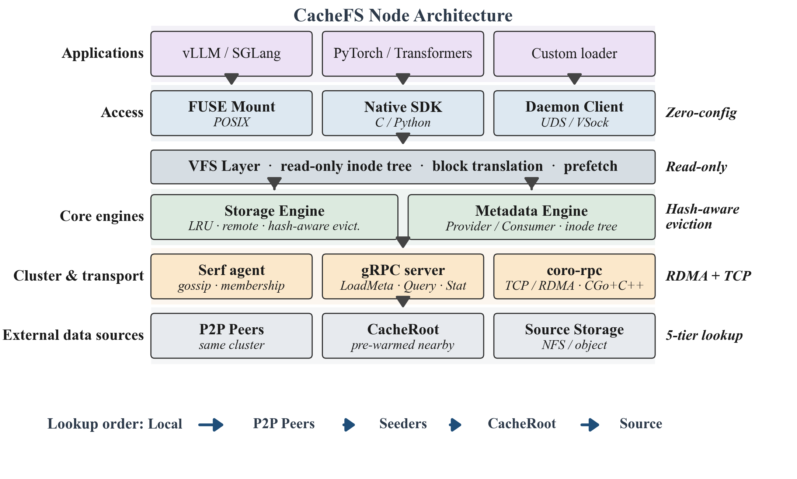
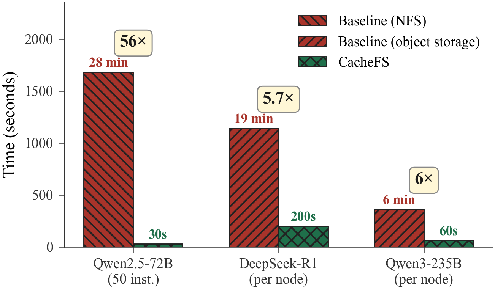
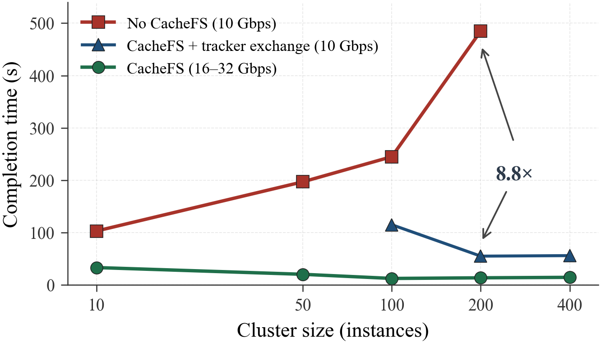

# CacheFS

CacheFS is a decentralized, read-only, distributed cache filesystem. It mounts
an existing POSIX directory — an NFS mount, an object-storage mount, or a plain
local directory — as a read-only FUSE filesystem, and caches the contents in
blocks spread over the memory or disks of every node in a cluster. There is no
central metadata service and no coordinator: nodes find each other by gossip
([serf](https://github.com/hashicorp/serf)), and their caches cooperate so
that what one node holds is available to all of them. The underlying storage
is only touched for data that no node has yet. Two assumptions hold throughout:
the source directory's contents do not change while it is served, and every
node in a cluster mounts the same source.

CacheFS is built for one narrow workload and exploits it hard: immutable bulk
data that many nodes read at the same time, in full and roughly in order —
model weights being the canonical example. For that workload a general-purpose
distributed filesystem buys you write semantics and a metadata server you never
use; CacheFS drops both and spends the budget on read bandwidth instead.

The code reuses the [JuiceFS](https://github.com/juicedata/juicefs) code
architecture, from which it derives; the core logic — metadata, cache store,
peer transfer and cluster membership — is reimplemented around the read-only,
source-mirroring model above.

## Architecture



A mount point mirrors its source directory: the metadata engine walks the
source and keeps an in-memory inode tree, and the VFS translates every read
into block-sized requests against the cache. A block is served from the local
cache if present, otherwise from whichever peer holds it, otherwise from the
source directory — and whatever comes from the source is cached on the way
through. Membership, block location and cluster-wide control commands all ride
on serf gossip; the bytes themselves move over a coroutine-based RPC layer
(coroutine RPC on TCP, optionally RDMA) that bypasses serialization-heavy
stacks. The mount is read-only by design: CacheFS never modifies the data it
serves, so a cached block can never be invalidated by a writer, and nodes can
serve each other's caches without any consistency protocol.

[docs/architecture.md](docs/architecture.md) covers the cluster-level view —
how nodes locate blocks in each other, how the cache decides what to keep — and
the internals of each layer.

## Performance

Measured during production scale-out events, end to end, with unmodified
inference frameworks reading through the FUSE mount:



Distributing Qwen2.5-72B to 50 instances takes 28 minutes over cloud NFS and
30 seconds with CacheFS (56×). The per-node figures compare against cloud
object storage.



Without CacheFS, a scale-out step takes longer the more instances start at
once, because they all share the upstream storage bandwidth. The horizontal
axis is the cluster size reached by growing the cluster step by step —
0 → 10 → 50 → 100 → 200 → 400 instances — and each point plots the completion
time of the step that reached that size. With a warm cooperative cache, every
step after the first completes in about the same time no matter how many
instances it adds.

Both figures are reproduced from the paper below (CC BY 4.0); it reports the
full methodology, more models, and the microbenchmarks behind the data plane.

## Build and Development

Build dependencies, RHEL family (Alibaba Cloud Linux 3, CentOS, RHEL):

```bash
sudo dnf install -y golang make cmake git g++ libstdc++-static rdma-core-devel
```

Debian/Ubuntu equivalents: `make cmake git g++ libibverbs-dev`, plus a Go
toolchain ≥ 1.22 (distro packages are often older; the official tarball works).
A C++20-capable compiler is required (GCC ≥ 10 or Clang ≥ 14). The RDMA data
path is compiled in unconditionally, so `rdma-core-devel` / `libibverbs-dev`
is needed at build time even if you only ever use TCP.

```bash
git clone --recurse-submodules https://github.com/aliyun/cachefs.git
cd cachefs
make                # produces ./cachefs
```

If the clone was made without `--recurse-submodules`, run
`git submodule update --init` first: the coroutine RPC library vendors
yalantinglibs as a submodule.

The same tree carries the checks used during development:

```bash
make vet             # go vet over pkg/, cmd/ and build/src/treesum
make fmt.check       # fails if any file needs goimports reformatting
make test            # unit tests with coverage
sudo make smoke.docker
```

`smoke.docker` needs root and docker: it rebuilds inside a privileged container
with `/dev/fuse` and host networking, runs the unit tests and benchmarks, then
starts two CacheFS nodes on loopback and exercises mount, preload, peer
transfer and clear against a generated source tree, verifying contents with
`treesum`.

## Documentation

- [Getting started](docs/getting-started.md) — the terms and assumptions you
  need, single-node and multi-node deployment, preload, and how to tell it is
  working.
- [Architecture](docs/architecture.md) — read path, metadata, cluster
  membership, cache management, the transport planes, and a glossary.

Command-line reference is the binary itself: `cachefs --help` and
`cachefs <command> --help`.

## Citation

```bibtex
@inproceedings{cachefs-atc26,
  title     = {CacheFS: Peer-to-Peer Cooperative Caching for LLM Weight
               Distribution at Cloud Scale},
  author    = {Liu, Zheng and Guan, Eryu and Zhao, Shang and Wei, Chengkun and
               Ma, Teng and Shi, Jin and Cao, Ye and Cao, Chen and
               Li, Wenpeng and He, Tao and Yu, Wenyuan and Ma, Tao and
               Chen, Wenzhi},
  booktitle = {The 2026 ACM SIGOPS Annual Technical Conference (SIGOPS ATC'26)},
  year      = {2026},
  doi       = {10.1145/3828523.3857016}
}
```

The paper is licensed under Creative Commons Attribution 4.0 International;
the figures in this README and in `docs/` are reproduced from it under that
license.

## License

Apache License 2.0. See [LICENSE](LICENSE) and [NOTICE](NOTICE).
