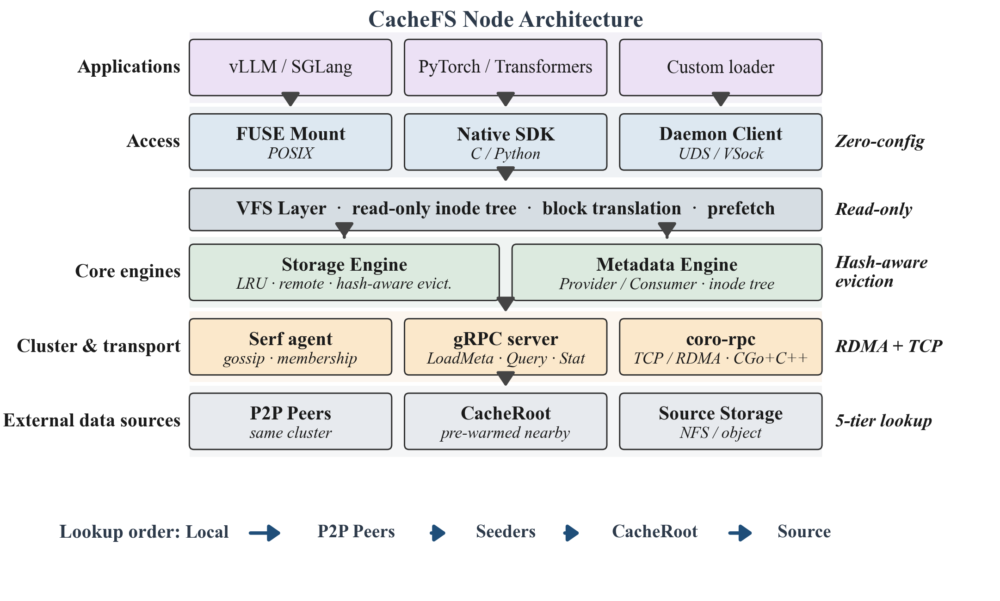
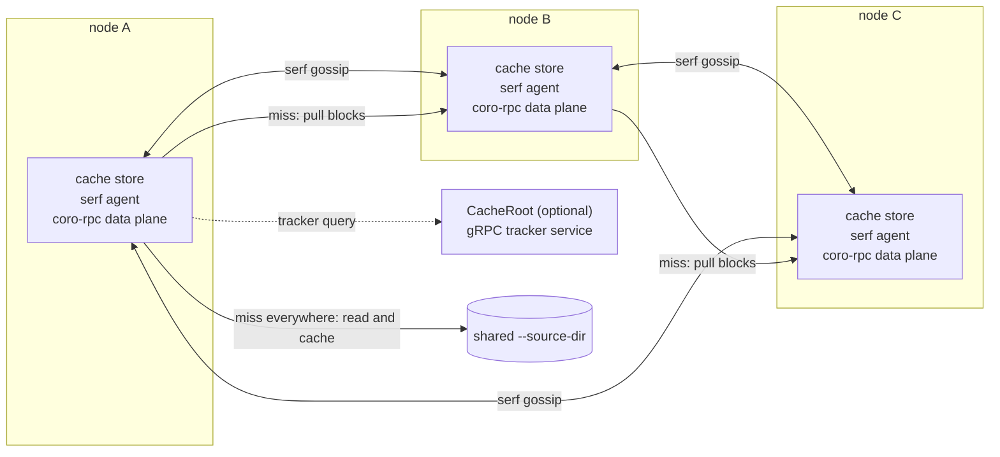

# Architecture

CacheFS is a stack of four things on every node: a read-only FUSE filesystem, a
block cache, a metadata engine, and a set of cluster channels. This page walks
a read through that stack, then describes each part and the rules by which the
cache keeps and drops data.

## One node

The FUSE layer is deliberately thin: it translates POSIX operations into VFS
calls and nothing more. The VFS owns the inode tree, translates file offsets
into block requests, and drives prefetch. The block cache holds block data in a
directory or in memory. The metadata engine owns the view of what files exist.
The two network-facing pieces — peer transfer and cluster control — are
separated because they have different latency and reliability requirements.

## The read path

A read of a block proceeds in this order:

1. **Local cache.** The block cache is asked first, whether it is the disk
   backend or the memory backend.
2. **An in-flight fill.** If the block is absent but another reader is already
   fetching it from the source, or already writing it into the cache, this read
   waits for that fill and retries the local cache, so a burst of readers for
   one block does not each go to the source.
3. **Peers.** The node consults its tracker — the gossip-built map of who
   caches what — and tries, in order: candidates the tracker names for this
   block, seeder nodes, the block's consistent-hash owner, and finally a
   CacheRoot query if one is configured. Each candidate is asked over the
   control plane and, if it has the block, the bytes come back over the data
   plane. Peers that fail are blacklisted for a while rather than retried.
4. **The source directory.** Only when no peer can serve the block is the
   source read, and the block is inserted into the local cache on the way
   through so the next reader — here or on any peer — misses less.

After a read, the VFS prefetches the following blocks asynchronously, using the
same order (peers before source), so sequential reads rarely wait on a miss.
A block's identity is its path relative to the source root plus its index; by
default the file's size and modification time are folded into that identity, so
a rewritten file does not alias onto blocks cached under the old content.

## Metadata

The metadata engine keeps an in-memory inode tree. In the normal shape it is
built by scanning the source directory; attributes are loaded lazily, and how
often the tree is re-validated is controlled by `--readdir-cache` (by default
never), because CacheFS is designed for sources whose contents do not change.

Three roles exist, chosen by how the node is started:

- **Provider** — has a source directory, scans it, and announces availability
  to the cluster.
- **Consumer (sourceless)** — has no source directory; it receives the whole
  tree from a provider over the control plane and serves reads entirely from
  the cluster cache.
- **Peer metadata** — has a source directory but prefers to load the tree from
  peers first, falling back to its own scan; useful when scanning the source is
  itself expensive.

Tree contents and block locations travel as serf user events. Because scale-out
produces bursts of announcements, events are coalesced by Lamport timestamp and
stale ones are filtered out of gossip sync buffers, so a joining node does not
have to digest the cluster's entire history.

## Cluster membership and block ownership

Membership is serf gossip; there is no master and no quorum. On top of the
member list each node maintains a consistent hash ring with virtual nodes. The
ring answers "which node owns this block", and ownership is what lets the
cluster behave like one big cache: see cache management below.

The same gossip channel carries three families of events: metadata
announcements, block tracker announcements (which node caches which blocks, and
revocations when it evicts them), and cluster-wide control commands such as
broadcast preload and clear.

A CacheRoot is an ordinary CacheFS node that additionally serves a gRPC tracker
service over its own (usually larger, pre-warmed) view of the cluster. It is
consulted when the local tracker cannot answer — typically right after a join
burst, or across serf groups. It only answers lookups: the data move directly
between the requesting node and the peers named in the answer.

## Transport planes

Three planes, chosen for their different jobs:

- **Data plane** — block bytes move over a coroutine-based RPC library (C++
  coroutines bridged with cgo), over TCP or RDMA. It exists because a
  serialization-heavy RPC stack caps throughput far below what the NICs can do.
- **Control plane** — gRPC carries block-load negotiation, tracker exchange,
  CacheRoot queries and metadata transfer. Low rate, high fan-out, strongly
  typed.
- **Local plane** — a ttrpc API over a unix socket exposes per-mount control
  (preload, clear, cache resizing, readiness, zero-copy block access) to
  orchestrators on the same host. A separate, deliberately simple binary
  protocol over another unix socket connects a FUSE process to a standalone
  cache daemon when the two are split (below), passing memory file descriptors
  so blocks cross the process boundary without copying.

## Cache management

The cache is block-granular and its retention policy is what makes the cluster
act like a single large cache rather than N copies of the same hot data.

**Backends and capacity.** Blocks live in a directory or in memory; memory
blocks are allocated outside the Go heap — anonymous mappings by default,
memory files when `CFS_PAGE_MEMFD_ALLOC` is set, which enabling the local API
server forces — so a large cache does not become a GC problem. `--cache-size`
caps the backend; `--burst-cache-size` allows a temporary overshoot, which is
what absorbs a scale-out wave, and shrinks back on demand or via
`cachefs clear --clear-burst`.

**Hash-aware eviction.** With the default eviction policy, each node treats the
blocks it owns on the consistent hash ring as the ones it should keep, and
blocks it does not own as the ones it should drop first. Because every node
applies the same rule to the same ring, the union of N partial caches converges
toward one cluster-sized cache without any node coordinating retention with
another. Under pressure eviction runs in rounds: R1 and R2 drop blocks this node
does not own (pairwise-oldest first, then everything), skipping pinned blocks;
R3 drops non-owned blocks including pinned ones; R4 drops owned-but-unpinned
blocks; R5, the last resort, drops everything including pins. The ownership
rounds only apply when the hash ring is enabled and the cluster has more than
one member — a lone node evicts pairwise-oldest over its whole cache. Blocks
currently mapped zero-copy into another process are skipped in every round,
including R5. An alternative, purely local policy (two-random-choice) is
available and is what the hash-aware policy is measured against in the paper.

**Other retention inputs.** Prefix pins keep chosen paths resident regardless
of ownership; a small recently-added window protects freshly loaded blocks from
immediate eviction; a free-space ratio guard stops the disk backend from
filling the filesystem; an optional TTL expires blocks by age; and a share
reserve caps how much of the cache a zero-copy consumer may lock, so an
external reader cannot starve the cache itself.

**Integrity.** Peer and source reads can be checksummed (crc32 or md5). A node
serving as a CacheRoot forces crc32 on, so it can answer both checksum-enabled
and plain clients; the rationale is that a stale block location is otherwise
hard to distinguish from corruption.

## Preload

Preload walks the metadata tree for the requested paths and issues block
fetches through the same path as reads — peers first, source as fallback —
stopping early if the cache is full or under eviction pressure unless told
otherwise. Broadcast preload sends the request as a gossip event so every node
runs the same walk locally; that is the mechanism behind warming a cluster
before a scale-out.

## Memory, GC and direct IO

Cache pages are allocated outside the Go heap — anonymous mmap by default,
memory files when requested — which is what lets a node cache tens or hundreds
of gigabytes without turning the garbage collector into a CPU tax. For the same
reason, when neither `GOGC`/`GOMEMLIMIT` nor `--go-gc`/`--go-memlimit` is set,
CacheFS disables GC and relies on an explicit memory limit; the heap holds
metadata and control structures, not cache data. A pool of pre-faulted blocks
keeps allocation off the read path, and transparent hugepage policy can be
adjusted at startup (`--thp-policy`) because cache-sized mappings benefit from
it; failures to write the sysfs knobs are warnings, never fatal.

Reads and writes to the cache and to the source can use `O_DIRECT`
(`--cache-read-direct-io`, `--cache-write-direct-io`, `--source-direct-io`) to
avoid double buffering. Support is probed per filesystem: if a filesystem
rejects `O_DIRECT`, that path falls back to buffered IO permanently and says so
once in the log, rather than failing every IO.

## Deployment shapes

The same binary covers several shapes; [getting started](getting-started.md)
walks through the first two.

- **Single node** — one mount, source directory, local cache.
- **Cluster** — any number of nodes joined by serf; caches cooperate.
- **Sourceless** — nodes with no source directory, serving purely from the
  cluster; the metadata tree arrives from providers.
- **Fuse/store separation** — `cachefs daemon` runs the cache as a standalone
  process and mounts connect to it over a unix socket, so several mounts share
  one cache and the cache survives a FUSE process restart.
- **CacheRoot tier** — always-on, pre-warmed nodes answering tracker queries
  for the cluster.

## Observability hooks

Every node serves Prometheus metrics (default `127.0.0.1:9678`) plus `/peers`
and `/serf_members` for cluster state; the mount exposes the same counters as
`.stats` and the effective configuration as `.config`. `cachefs stats` renders
the counters live and `cachefs profile` summarizes the access log. See
`cachefs --help` for the full surface.

## Glossary

| Term | Meaning |
| --- | --- |
| Source directory | The POSIX directory being mirrored: an NFS mount, an object-storage mount, or a local directory. CacheFS never writes to it, and assumes its contents do not change while it is served. |
| Mount point | The read-only FUSE filesystem CacheFS creates. |
| Block | The unit of caching and transfer; reads are translated into block-sized requests. Default 64 MiB, configurable to 4/16/32/64/128 MiB with `--block-size`. |
| Cache backend | Where a node keeps blocks: a directory (`--cache-dir /path`) or host memory (`--cache-dir memory`, the default). |
| Cache size | The cap on the backend in MiB (`--cache-size`, default 131072 = 128 GiB). A burst cache (`--burst-cache-size`) may temporarily exceed it during scale-out. |
| Cluster | The set of nodes sharing one cache, joined by serf gossip; no master node. |
| Tracker | A node's in-memory map of which peer caches which blocks, built from gossip; what makes a miss resolvable to a specific peer. |
| CacheRoot | An optional always-on, pre-warmed node answering "who has this block" for the cluster, including across serf groups. |
| Preload | Fetching paths into the cache ahead of demand, peers first; `--broadcast` runs it on every node. |
| Sourceless | A node started without a source directory (`--sourceless`); it receives the metadata tree from peers and serves reads entirely from the cluster. |
